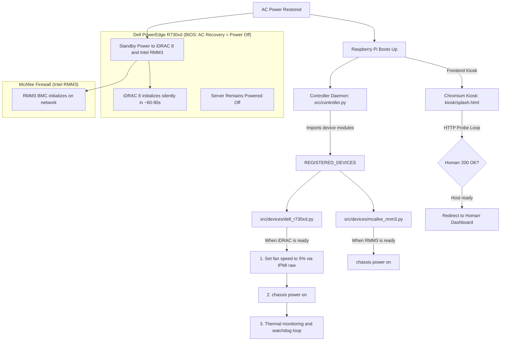

# Dell PowerEdge R730xd Silent Boot & Homelab Kiosk Controller

Modular controller designed for a **Raspberry Pi** (Raspberry Pi OS Bookworm / Debian 12). It eliminates server jet-engine noise during power recovery on **Dell PowerEdge R730xd** servers, coordinates power management for an **Intel RMM3-based McAfee firewall**, and provides a **full-screen kiosk frontend** with dynamic splash screen for **Homarr**.

---

## Architecture Overview



---

## Modular Device Architecture

Every server or appliance target is isolated in its own module inside `src/devices/[DEVICE].py` implementing `BaseDevice`:
* `src/devices/dell_r730xd.py`: Encapsulates all silent boot IPMI raw commands, fan speed percent calculations, SDR temperature queries, thermal curve evaluation, and watchdog failsafe.
* `src/devices/mcafee_rmm3.py`: Encapsulates Intel RMM3 BMC discovery and power-on logic.

In `src/controller.py`, targets are declared in `REGISTERED_DEVICES`:
```python
REGISTERED_DEVICES = {
    "dell_r730xd": "src.devices.dell_r730xd.DellR730xd",
    "mcafee_rmm3": "src.devices.mcafee_rmm3.McAfeeRMM3",
}
```

Devices can be enabled or disabled directly in `config.yaml` without editing any Python scripts:
```yaml
dell_r730xd:
  enabled: true

mcafee_rmm3:
  enabled: false
```

---

## BIOS Configuration Requirement

### Dell PowerEdge R730xd
1. Enter BIOS settings (`F2` during boot).
2. Navigate to **System Security** or **Power Management** -> **AC Power Recovery**.
3. Set value to **`Power Off`** (or *Remain Off*).
4. In iDRAC web interface:
   * Verify **IPMI over LAN** is enabled (*iDRAC Settings -> Network -> IPMI Settings -> Enable IPMI over LAN*).

---

## Installation on Raspberry Pi

Clone or copy this repository to your Raspberry Pi and run:

```bash
cd /home/manu/idrac-silent-boot
sudo ./install.sh
```

---

## Configuration

### Credentials (`.env`)
```env
DELL_IDRAC_HOST=192.168.1.120
DELL_IDRAC_USER=root
DELL_IDRAC_PASSWORD=calvin

MCAFEE_RMM3_HOST=192.168.1.121
MCAFEE_RMM3_USER=admin
MCAFEE_RMM3_PASSWORD=password

HOMARR_URL=http://192.168.1.100:7575
```

### Operational Parameters & Fan Curve (`config.yaml`)
```yaml
general:
  poll_interval_seconds: 5
  bmc_boot_wait_timeout_seconds: 300
  bmc_probe_interval_seconds: 3

dell_r730xd:
  enabled: true
  initial_fan_speed_percent: 5
  power_on_delay_seconds: 2
  watchdog:
    max_consecutive_failures: 4
    emergency_temp_celsius: 78
    emergency_recovery_celsius: 65
  fan_curve:
    - min_temp: 75
      action: "manual"
      fan_speed_percent: 50
    - min_temp: 65
      action: "manual"
      fan_speed_percent: 25
    - min_temp: 55
      action: "manual"
      fan_speed_percent: 12
    - min_temp: 45
      action: "manual"
      fan_speed_percent: 7
    - min_temp: 0
      action: "manual"
      fan_speed_percent: 4

mcafee_rmm3:
  enabled: true
  auto_power_on: true

kiosk:
  initial_delay_seconds: 5
  check_interval_seconds: 3
```

---

## Service Management

Start service:
```bash
sudo systemctl start idrac-silent-boot.service
```

View live logs:
```bash
sudo journalctl -u idrac-silent-boot.service -f
```

Stop service (restores automatic fan control to Dell BIOS before exiting):
```bash
sudo systemctl stop idrac-silent-boot.service
```

---

## Unit Testing

Run test suite:
```bash
python3 -m unittest tests/test_components.py
```
