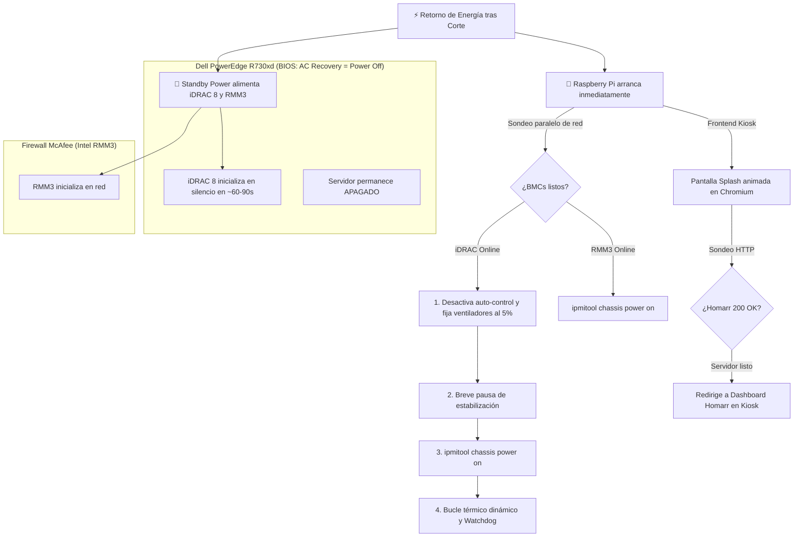

# Dell PowerEdge R730xd Silent Boot & Homelab Kiosk Controller

Controlador integral diseñado para ejecutarse en una **Raspberry Pi** (Raspberry Pi OS Bookworm / Debian 12). Resuelve el molesto problema de arranque ruidoso ("jet engine" a 100% de ventiladores) tras cortes eléctricos nocturnos en servidores **Dell PowerEdge R730xd**, coordina el encendido de un firewall **McAfee basado en Intel RMM3**, y proporciona un **frontend kiosk en pantalla completa** con splash screen dinámico para **Homarr**.

---

## 💡 El Problema con el Control Local de Ventiladores

En repositorios como [nagaeki/dell-idrac-fancontrol](https://github.com/nagaeki/dell-idrac-fancontrol), el script se ejecuta directamente en el sistema operativo del servidor Dell. Cuando hay un corte de luz en la madrugada y la energía retorna:

1. El servidor arranca por hardware.
2. Durante todo el ciclo de **POST**, comprobación de memoria y carga de Linux (3 a 5 minutos), los ventiladores giran al **100% de potencia** generando un ruido ensordecedor.
3. El script local sólo toma el control una vez que el sistema operativo finaliza el arranque.

### 🛡️ La Solución de Silent Boot (Out-of-Band con Raspberry Pi)

Este proyecto traslada el control térmico y de energía a una **Raspberry Pi**:



1. **BIOS de Dell configurada en `AC Power Recovery -> Power Off (Remain Off)`**: El servidor principal **permanece apagado**. Solo el BMC (iDRAC 8) arranca en silencio consumiendo energía en standby.
2. La Raspberry Pi detecta que el iDRAC ya responde en la red local.
3. **Antes** de presionar el botón de encendido virtual (`chassis power on`), la Raspberry Pi envía comandos IPMI raw para silenciar los ventiladores (por ejemplo al 4% - 5% RPM).
4. La Raspberry Pi enciende el servidor. El POST y arranque del Dell se ejecutan en **total silencio**.
5. Un daemon continuo monitorea las temperaturas de los procesadores vía IPMI LAN y ajusta los ventiladores según una **curva térmica configurable en YAML**.

---

## 🚀 Características Principales

* **Arranque Verdaderamente Silencioso:** Silencia las turbinas del Dell R730xd antes del arranque del sistema.
* **Control Paralelo:** Detecta y enciende el firewall McAfee (Intel RMM3) simultáneamente apenas su BMC está en línea.
* **Curva Térmica Personalizable en YAML:** Define tramos de temperatura y velocidades en porcentaje (presets basados en nagaeki con transiciones suaves).
* **Watchdog de Alta Seguridad:**
  * Si fallan lecturas de temperatura consecutivas (iDRAC no responde o red caída), **restaura automáticamente el control dinámico de la BIOS de Dell** para evitar sobrecalentamiento.
  * Si la temperatura supera el umbral crítico configurado (ej. 78°C), entrega inmediatamente el control a la BIOS de Dell.
  * Al detener o reiniciar el servicio (`SIGTERM`/`SIGINT`), restaura el modo automático de fábrica de Dell.
* **Frontend Homarr Kiosk Inteligente:**
  * Interfaz moderna y oscura con animaciones y contador de tiempo.
  * Evita la pantalla de error de Chromium (`ERR_CONNECTION_REFUSED`) mientras el servidor bootea.
  * Sondea la disponibilidad de Homarr y redirige fluidamente cuando el dashboard está listo.
* **Compatibilidad:** Diseñado específicamente para Raspberry Pi OS Bookworm (Debian 12 con Wayland / Labwc / Wayfire y X11).

---

## ⚙️ Configuración Previa de Hardware

### 1. Dell PowerEdge R730xd (iDRAC 8)
1. Entra a la configuración de la **BIOS** (`F2` durante el arranque).
2. Ve a **System Security** o **Power Management** -> **AC Power Recovery**.
3. Configúralo en: **`Power Off`** (o *Remain Off*).
4. En la interfaz web de iDRAC:
   * Verifica que **IPMI over LAN** esté habilitado (*iDRAC Settings -> Network -> IPMI Settings -> Enable IPMI over LAN*).
   * Ten a mano la IP, usuario y contraseña de iDRAC.

### 2. Firewall McAfee (Intel RMM3)
* Verifica la dirección IP del puerto de gestión dedicado BMC/RMM3 y sus credenciales IPMI.

---

## 📦 Instalación en la Raspberry Pi

Clona o copia este repositorio en la Raspberry Pi y ejecuta el instalador automatizado:

```bash
cd /home/manu/idrac-silent-boot
sudo ./install.sh
```

El script de instalación realiza:
1. Instalación de paquetes necesarios: `ipmitool`, `python3`, `python3-yaml`, `chromium-browser`, `unclutter`.
2. Creación del archivo `.env` con permisos restringidos (`chmod 600`).
3. Creación del archivo `config.yaml` para la curva de ventiladores.
4. Instalación y habilitación del servicio Systemd `idrac-silent-boot.service`.
5. Configuración del autostart del Kiosk en `~/.config/autostart/homarr-kiosk.desktop`.

---

## 🔧 Archivos de Configuración

### 1. Credenciales (`.env`)
Protegido con permisos estrictos `600`:

```bash
# Dell PowerEdge R730xd (iDRAC 8)
DELL_IDRAC_HOST=192.168.1.120
DELL_IDRAC_USER=root
DELL_IDRAC_PASSWORD=tu_password_idrac

# Firewall McAfee (Intel RMM3)
MCAFEE_RMM3_HOST=192.168.1.121
MCAFEE_RMM3_USER=admin
MCAFEE_RMM3_PASSWORD=tu_password_rmm3

# Frontend Kiosk
HOMARR_URL=http://192.168.1.100:7575
```

### 2. Curva Térmica y Parámetros (`config.yaml`)

```yaml
general:
  poll_interval_seconds: 5
  bmc_boot_wait_timeout_seconds: 300
  bmc_probe_interval_seconds: 3

dell_r730xd:
  enabled: true
  initial_fan_speed_percent: 5   # Silenciado previo al power-on
  power_on_delay_seconds: 2

  watchdog:
    max_consecutive_failures: 4  # Si fallan 4 lecturas, devuelve el control a Dell
    emergency_temp_celsius: 78    # Por encima de esta temp, cede el control a Dell
    emergency_recovery_celsius: 65

  fan_curve:
    - min_temp: 75
      action: "manual"
      fan_speed_percent: 50
    - min_temp: 65
      action: "manual"
      fan_speed_percent: 25
    - min_temp: 55
      action: "manual"
      fan_speed_percent: 12
    - min_temp: 45
      action: "manual"
      fan_speed_percent: 7
    - min_temp: 0
      action: "manual"
      fan_speed_percent: 4

mcafee_rmm3:
  enabled: true
  auto_power_on: true
```

---

## 🖥️ Gestión del Servicio Backend

Para iniciar el servicio inmediatamente:
```bash
sudo systemctl start idrac-silent-boot.service
```

Para consultar el estado y logs en tiempo real:
```bash
sudo systemctl status idrac-silent-boot.service
sudo journalctl -u idrac-silent-boot.service -f
```

Para detener el servicio (restaurará automáticamente el control dinámico a Dell):
```bash
sudo systemctl stop idrac-silent-boot.service
```

---

## 🧪 Pruebas Unitarias

El proyecto incluye tests automáticos para verificar el parser de entorno, el procesamiento de las cadenas térmicas de `ipmitool`, la curva de ventiladores y el watchdog de emergencia:

```bash
python3 -m unittest tests/test_components.py
```
